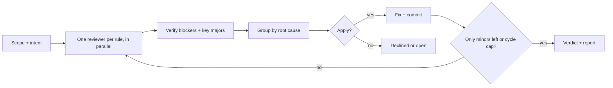

# tribunal

Code quality rules, one skill each, and `tribunal`: one subagent per rule reviews a diff, the findings get verified, and the code gets fixed until a run leaves no blocker or major to apply.

## Install

Claude Code:

```sh
claude plugin marketplace add buhond/skills && claude plugin install tribunal@buhond
```

Cursor: add `buhond/skills` as a plugin marketplace and install `tribunal`.

## Use

`/tribunal:tribunal` on a branch, or `/tribunal:tribunal 5` to allow five cycles instead of three. It commits its fixes and never pushes.

Every other skill in [`skills/`](skills) is a rule, and applies while writing code too, e.g. `/tribunal:kiss`.

## How it works



1. **Scope:** diffs the branch against the PR's base branch, or the remote's default branch, and writes one paragraph on what the change is for.
2. **Review:** one read-only subagent per rule replies with every problem it suspects. Correctness, security and performance get the strongest model; the rest a faster one.
3. **Verify:** fresh subagents, all at once, try to refute each blocker, and each major from kiss, no-slop, dry, single-responsibility and performance.
4. **Group:** findings one fix would resolve are merged.
5. **Decide and fix:** it applies a finding unless it's a hypothetical no real caller hits, an abstraction nothing needs yet, pure taste, or against the change's intent. Fixes that touch separate files run in parallel subagents; tests and the type check run once.
6. **Loop:** it reruns on the fix alone until a cycle leaves no blocker or major to apply (its minors get fixed without another run), and never reverses a fix it already made.

It **fails** if the last cycle left a blocker unapplied, a rule unreviewed or a finding unverified.
